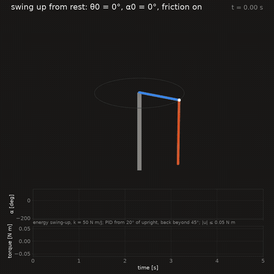

# Furuta Pendulum

A rotary (Furuta) inverted pendulum simulated from first principles in Python, with controllers that swing it
up from rest and balance it.



*Energy swing-up from rest handing over to the PID near upright, torque capped at 0.05 N m.*

## About

A learning project. The plant is a Quanser QUBE-Servo 2: a motor turns a horizontal arm, and a pendulum swings
freely at the arm's tip. Everything is built from the physics up:

- **Model.** Lagrangian equations of motion derived symbolically in [CasADi](https://web.casadi.org/),
  reproducing Cazzolato & Prime (2011), with smooth Stribeck friction and Quanser's published parameters.
- **Simulation.** The torque is held constant over each 1 ms controller sample and RK4 integrates in between;
  every run checks its energy balance.
- **Controllers.** Open loop; two summed PIDs (pendulum and arm) whose gains are tuned by IPOPT on the
  simulated closed loop; energy-based swing-up (Åström & Furuta 2000) handing over to the PID. Every controller
  is capped at 0.05 N m, the real motor at 10 V.
- **Disturbances.** A short torque pulse (a tap) on the pendulum while it balances.

The equations, parameters, controller laws and their sources are in [METHODS.md](METHODS.md).

## Installation

Needs [uv](https://docs.astral.sh/uv/), and `gcc` for the gain tuner only. From the project folder:

```
uv sync
```

This creates `.venv/` with Python 3.13 (pinned in `.python-version`) and the exact library versions pinned in
`uv.lock`.

## Usage

```
uv run python run.py
```

Simulates the experiments named in `config.RUN`, prints the key numbers of each, and writes a figure and a
real-time video per experiment to `results/<controller>/<name>.png` and `.mp4`. Every parameter and setting
lives in `config.py`. An experiment (`config.EXPERIMENTS`) is an initial state, a duration, friction on or off,
a controller with its settings, and optionally a disturbance; `RUN = list(EXPERIMENTS)` runs them all.

```
uv run python tune.py
```

Tunes the PID gains by optimization and prints them, ready to paste into `config.PID_GAINS`. It compiles one
closed-loop sample to C, hence `gcc`.

## Checks

Every run checks that the state stays finite, that the energy balance closes
(E(t) − E(0) = motor work + disturbance work − friction loss, within `config.ENERGY_TOL`), and that friction
never adds energy. A failed check does not stop the run: it is printed, written in red on that run's figure
and video, and `run.py` ends by listing the failed runs, with exit status 1. There is no test suite.

## Project layout

| File | Role |
|---|---|
| `config.py` | every parameter and setting: plant, torque cap, PID gains, tuning, swing-up, experiments |
| `model.py` | the plant: kinematics, Lagrangian, equations of motion, friction, RK4 step |
| `control.py` | controllers (`open_loop`, `pid`, `swing_up`) and the PID law shared with the tuner |
| `run.py` | simulation loop, checks, key numbers |
| `tune.py` | PID gain tuning by optimization |
| `viz.py` | figures and videos |
| `METHODS.md` | model, numerics and controllers, with references |
| `media/` | the GIF above |

## Limitations

- Simulation only; no hardware.
- The controllers see the true state: no sensor noise, encoder quantization or state estimation.
- The motor is a pure torque source: its electrical dynamics and back-EMF are not modelled.
- The pendulum joint has viscous friction only; Quanser publishes no Coulomb value for it.

## References

The main sources; the full list is in [METHODS.md](METHODS.md#references).

- B. S. Cazzolato, Z. Prime, "On the dynamics of the Furuta pendulum", *Journal of Control Science and
  Engineering*, vol. 2011, art. 528341, 2011. doi:10.1155/2011/528341
- K. J. Åström, K. Furuta, "Swinging up a pendulum by energy control", *Automatica* 36(2), 287–295, 2000.
- J. A. E. Andersson, J. Gillis, G. Horn, J. B. Rawlings, M. Diehl, "CasADi: a software framework for
  nonlinear optimization and optimal control", *Mathematical Programming Computation* 11(1), 1–36, 2019.
- A. Wächter, L. T. Biegler, "On the implementation of an interior-point filter line-search algorithm for
  large-scale nonlinear programming", *Mathematical Programming* 106(1), 25–57, 2006.

## License

[MIT](LICENSE)
